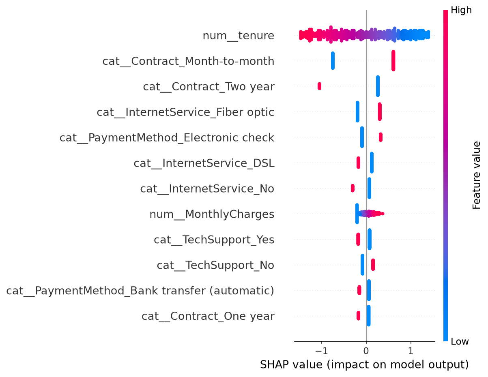

# Customer Churn Prediction with Explainability

Predicts which telecom customers are likely to leave, **explains why** with SHAP, and serves
predictions through a Streamlit app with a suggested retention action.

> **Live demo:** _add your Streamlit Community Cloud / Hugging Face Spaces link here_

## Business problem
Acquiring a new customer costs far more than retaining one. This project flags high-risk
customers early so the retention team can act, and shows *which factors* drive each prediction.

## Dataset
[Telco Customer Churn (Kaggle)](https://www.kaggle.com/datasets/blastchar/telco-customer-churn),
7,043 customers, 20 features. Save it as `data/telco_churn.csv`.
(`python src/make_sample_data.py` creates a synthetic stand-in so the code runs without the download.)

## Approach
1. Clean data (fix blank `TotalCharges`, encode target).
2. sklearn `Pipeline`: StandardScaler + OneHotEncoder + model (no data leakage).
3. Compare a majority-class baseline, Logistic Regression, Random Forest and XGBoost on a
   stratified hold-out set, with class imbalance handled.
4. Explain the best model with SHAP (global summary plot and per-customer waterfall).
5. Serve through Streamlit.

## Results
_Replace with your numbers from `reports/model_comparison.csv` after training on the real data._

| Model | ROC-AUC | Precision | Recall | F1 |
|---|---|---|---|---|
| Baseline | 0.500 | 0.000 | 0.000 | 0.000 |
| Logistic Regression | | | | |
| Random Forest | | | | |
| XGBoost | | | | |



## Key insights
_Write 3 findings from your SHAP plot, e.g. "Month-to-month contracts and short tenure are the
strongest churn drivers; customers with tech support churn less."_

## Recommended actions
- Move month-to-month customers to annual contracts with a discount.
- Bundle tech support for high-risk fiber customers.
- Nudge electronic-check users toward automatic payments.

## Run it
```bash
python -m venv .venv && source .venv/bin/activate   # Windows: .venv\Scripts\activate
pip install -r requirements.txt
python src/train.py
streamlit run src/app.py
```

## Project structure
```
src/preprocess.py        cleaning + preprocessing pipeline
src/train.py             model comparison, saving, SHAP
src/app.py               Streamlit app
src/make_sample_data.py  synthetic data generator (testing only)
reports/                 metrics table and SHAP plot
```

## Next steps
Hyperparameter tuning (Optuna), probability calibration, threshold selection based on retention
cost vs. customer lifetime value, Docker, and drift monitoring.
